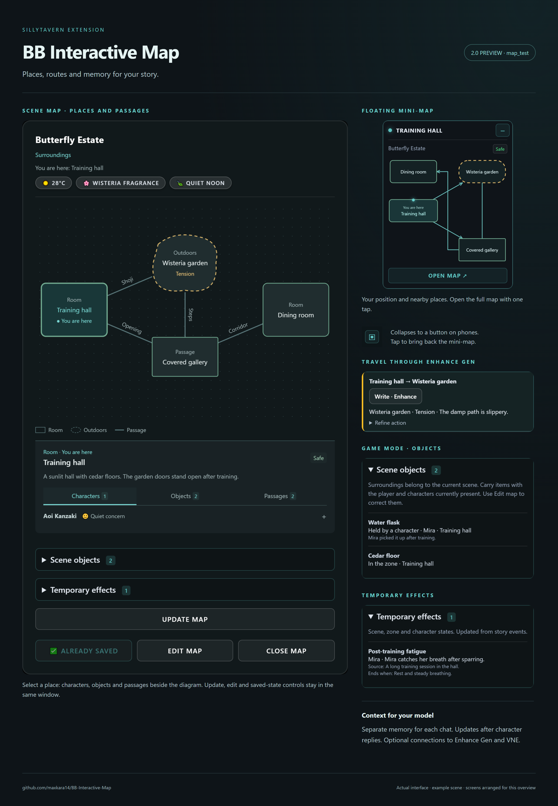

# BB Interactive Map

[Русский](README.md) · **English** · [Changelog](CHANGELOG.md#english)

A **SillyTavern** extension that turns story events into a map of places and passages. Track your position, characters, objects and scene conditions, and give the model spatial memory of the current chat.

**Version 2.0.3**

[Full-size image](docs/images/overview.en.png) · [Russian overview](docs/images/overview.ru.png).

## Features

| Feature | What it does |
|---|---|
| **Places and passages** | Rooms, outdoors, areas and corridors form a schematic with doors, paths, stairs and openings |
| **Floating mini-map** | Shows your position and nearby places, opens the full map and remembers widget position |
| **Scene memory** | Saves a separate map for each chat and supplies it to the model |
| **Location archive** | Stores snapshots within each chat: view, rename, delete or return with a story-based refresh |
| **Updates after character replies** | Prepares a map after a reply or reroll, with review or automatic saving |
| **Review, edit and rollback** | Shows changes, lets you correct the map and restores the previous snapshot |
| **Mention cards** | Highlights map names in messages; clicking opens their description and location |
| **Classic / Game** | Spatial memory, or additional travel drafts, object possession and temporary effects |
| **RU / EN** | Browser language, Russian or English interface; descriptions follow the chat language |
| **Three sources** | Current connection, Connection Manager profile or OpenAI-compatible Custom API |

## Installation

1. Open **Extensions → Install extension** in SillyTavern.
2. Paste `https://github.com/maxkara14/BB-Interactive-Map`.
3. Reload the page. If the old interface remains, use **Ctrl+F5** on desktop.

Install [BB Enhance Generation](https://github.com/maxkara14/BB-Enhance-Gen) for generated travel descriptions. [BB Visual Novel Engine](https://github.com/maxkara14/BB-Visual-Novel-Engine) can also use the map when generating response options. These integrations are optional; update the extensions to access their map-context settings.

## Quick start

1. Open a character or group chat.
2. In **Extension settings → BB Interactive Map**, choose a generation source. The current SillyTavern connection is the default.
3. Under **Current chat map**, choose **Current scene** or **Surroundings**, then **Run new scan**. The floating button also offers the first scan when no map exists.
4. Review the proposal. Use **Edit map** if needed, then save.
5. Open the saved map from the mini-map. **Update map** starts another scan; **Cancel generation** is available in the map and settings during a request. A saved map shows **✅ Already saved**.

## Read and edit the map

Place outlines depend on their type. Passage names follow their lines; arrows indicate route direction. Select a place for its description and **Characters**, **Objects** and **Passages** tabs. Expand entries for details; long passage names remain available here when they do not fit on the diagram.

**You are here** marks the known player position. Mini-map status belongs to that place rather than its most dangerous neighbor. Green, amber and red indicate safety, tension and danger. Outdoors have animated dashed outlines; other places keep solid borders and glow for threats. **Map animations** can be disabled, and system reduced-motion settings are respected.

**Edit map** adds or removes places and passages, sets player position, and corrects descriptions, characters, objects and threats. Game mode also edits possession and effects. Edits return to a proposal and are saved when applied. Settings can restore the previous map or clear current memory.

Older 3×3 maps still open in their original format. A saved new scan adopts the new schematic; rollback supports both formats. The diagram represents established connections, not a measured floor plan.

### Desktop and phone

Drag the widget header to move it; its focused header also accepts arrow keys. Position and collapsed state are remembered. On phones the collapsed widget becomes a square button: tap it for the mini-map, then choose **Open map**. Without a map it offers creation. The button can be dragged; the full map scrolls and keeps bottom actions accessible.

## Automatic updates

Enable **Prepare an update after each reply**. By default, a completed character response, continuation or reroll triggers one map request. **Update every N character responses** sets the interval; separate switches exclude continuations and regenerations/swipes from the count. User messages, manual edits and duplicate reply events do not count. Switching chats, disabling updates or changing scan settings resets the counter. Existing memory remains in use while the proposal is prepared.

- By default, the proposal waits for review and saving.
- **Save updates automatically** enables updates after replies and applies suitable updates immediately, including an existing proposal, keeping the previous map for rollback. The first map can be created automatically after a character reply without a prior manual save.
- Uncertain position, places, passages, possession or effects may require review. Duplicate events for the same reply never trigger a new request. The next eligible response removes a stale proposal; a fresh scan follows the configured interval.
- Manual map scans always open a preview for confirmation, even with automatic saving enabled.
- In the full map, **Needs review** before the update button lets you confirm an individual place or passage availability. Clicks change only the preview; apply the result with **Save map**. Confirming passage availability allows routing through it. Archive snapshots cannot be edited.
- When automatic saving pauses, the widget and settings show why; identical popup warnings do not repeat on subsequent replies. New uncertain places or passages need manual review. **Save with uncertainty** accepts the snapshot while retaining dashed lines and uncertainty markers. Once accepted, unchanged uncertainties no longer pause automatic saving; unknown player position and archive returns still require review.

Cancelled responses are discarded. Changing chats prevents a late result from replacing another chat's map. Updates use a separate request and do not create a character reply.

When a scan waits for SillyTavern generation, chat saving or another map scan, the widget and settings show the reason. Waiting pauses after two minutes. Finish the current operation and select **Retry**; the extension never clears another operation's busy state or forces a concurrent request. A waiting scan can also be cancelled.

## Context, fields and colors

- **Scan context:** 1–100 recent messages, default 3. **History token limit** bounds the added history text; `0` disables the limit. Older messages are omitted first, retaining the end of an oversized latest message if necessary. Counts use the current SillyTavern connection tokenizer and may differ for a profile or Custom API model. Instructions, previous map and archive are not truncated; the main connection can also include additional SillyTavern context. This is not a limit on the entire request. The **response** allowance stays at 10,000 tokens.
- **Tracked fields:** independently enable atmosphere, characters, objects, mood, attitude and thoughts. Disabled fields are excluded from new scans, rendering, mention cards and map context, including the macro and integrations. Switching does not rewrite snapshots: old data becomes visible again when enabled, until a newly saved scan replaces it. Places, passages, player position and threats remain; Game mode controls temporary effects.
- **Map colors:** accent/route, background, primary text, three threat levels, and independent character, object and place mention colors. Mention colors apply to highlights in messages and type labels in cards. Changes apply immediately; **Reset colors** restores the original appearance. These settings apply across chats.

## Location archive

Ordinary scans and renaming update the active entry by ID. A distinct new scene needs narrative evidence; unclear boundaries offer **Update current location** or **This is a new location**. A model `null` alone does not create an entry.

**Clear memory text** removes the active map and its context while keeping the archive. Use **Delete from archive** on an individual entry and confirm deletion. The active entry is protected: switch maps or clear active memory first. Deleting a snapshot leaves chat messages and other entries unchanged.

Settings include a **Location archive** section. Accepted maps become separate snapshots in the current chat; saving the same location again updates its snapshot. One-step map rollback stays separate. Use **Add current map to archive** for an old map; simply opening an old chat does not rewrite its data.

- **View** opens a historical snapshot without changing memory, editing or preparing travel. You can rename entries in the list.
- During scans, the model receives a list of known locations. Recognizing a return to another saved location produces a **Return to the map** proposal, even with automatic saving enabled. Recognition depends on the model; choose an entry manually when ambiguous.
- **Return and refresh** makes one additional request using the old layout and current narrative. Old characters, objects, threats and effects are not automatically restored; player position and passage states are checked again. Game mode preserves established carried possessions from current memory. Review and save the result.
- **This is a new location** keeps similar names as separate entries: choose it, then use the regular save button. Viewing a map or intending to travel there alone never switches the active location.

Only the active map is sent to story context. The archive stores each location's latest accepted snapshot, not its complete history. Clearing current memory leaves the archive available for returns.

## Classic and Game modes

The mode is saved **per chat**. Both modes include the map, widget, memory, updating, mention cards and safety indicators.

**Classic** keeps spatial memory: places, passages, characters, objects and atmosphere.

**Game** additionally tracks:

- **Scene objects:** location, holder or uncertain whereabouts. Established player possessions follow the player; NPC possessions remain relevant while their holders are present. Old surroundings do not accumulate after scene changes.
- **Temporary effects:** scene, zone or character states with a cause and end condition. Applicable effects persist until story events establish their ending.
- **Travel drafts:** select a place reachable through confirmed passages and prepare an action in the chat input. Sending is manual; the next scan updates position from narrative results.

Switching to Classic hides game panels and instructions while preserving records for switching back.

### Travel through Enhance Gen

Choose **Travel writing → Through Enhance Gen**. Select a destination and optionally refine the action, then **Write · Enhance**. The map closes during generation; Enhance uses its own connection, persona, language, narrative person and Director “Me” token limit.

The result is appended to your draft without sending it. Use Enhance's cancel control beside the chat input during generation and **Restore original** afterwards. Changed drafts, chats or maps prevent stale results from being applied. **Simple text** remains a local template without Enhance or a model request.

## Mention cards

Enable **Highlight map mentions in chat** under **Interface**. Each entity is highlighted once per message: full name, unique first name and surname share one allowance. Supported honorifics and visual spacing such as `ㅤ` do not create duplicates.

New scans ask the model for **mention variants** for places, characters and objects in the same request. For example, «Раздвижные сёдзи» can match «сёдзи», and «Ступени крыльца» can match «ступени». Variants are stored with each entity in the current chat's map data and included in archive snapshots. A variant shared by multiple entities is skipped; all variants of one entity share one highlight.

Lists are hidden from the map and regular cards and excluded from story memory, the macro and integration context. To correct them, open **Edit map → Mention variants** for a place, character or object; the disclosure is closed by default. Enter one variant per line, up to 16, each 2–120 characters; HTML and control characters are rejected. Preview edits and save the map. Clearing an existing list leaves only full-name matching.

If a later scan omits the list for the same uniquely identified entity with an unchanged name, saved variants are retained; an explicit list replaces them. Old maps without the field retain full-name matching, unique character names/surnames and inflections for supported common objects. Reading never rewrites maps. New variants require a newly saved scan or manual editing.

Matching is local and does not rewrite messages or request the model. Ambiguous mentions, hidden blocks, code, links and inputs are skipped. Variant quality depends on the model: format is validated, but grammatical and semantic accuracy is not guaranteed. Arbitrary paraphrases without a stored variant and names split across HTML elements are not matched. Connection names from the Passages tab are not indexed yet.

## Context and integrations

Saved memory is injected into the chat model context by default. To place it yourself, enable the macro setting and use **`{{bb_map}}`** in your prompt; automatic injection then stops. The macro is empty when manual placement is disabled.

Enhance and VNE have their own **Use map context** switches, off by default:

- **Enhance:** adds the map to Enhance, Improve, custom writing buttons and Director **To me**.
- **VNE:** adds it to VN response-option generation.

These use the saved map of the active chat. Without a map or with the switch off, generation continues without that additional context. Enhance travel receives map context directly from the map action. Game effects and instructions are included only in Game mode.

## Connections

| Source | Behavior |
|---|---|
| **Current SillyTavern connection** | Active chat model |
| **Connection profile** | Connection Manager profile without switching the active connection |
| **Custom API** | Separate OpenAI-compatible URL, key and model; browser request |

An unavailable profile reports an error. Custom API failures fall back to the current connection; cancellation does not trigger fallback. Scan output allowance is **10,000 tokens**, subject to provider limits. Map quality depends on the model and evidence in recent messages.

## Author

[BruniikBron: Lo-Fi & Mods](https://bblofi.online/) · [Telegram](https://t.me/Brun11kBr0n)
