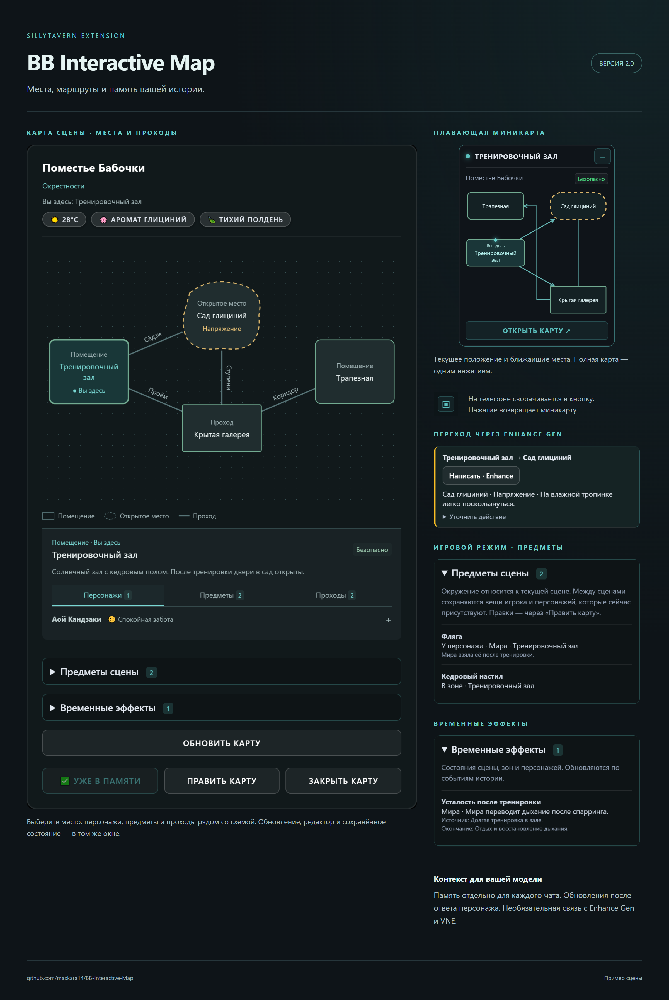

# BB Interactive Map

**Русский** · [English](README.en.md) · [Changelog](CHANGELOG.md#русский)

Расширение **SillyTavern**, которое превращает события истории в карту мест и проходов. Показывает положение игрока, персонажей, предметы и состояния сцены, а сохранённая карта помогает модели учитывать окружение текущего чата.

**Версия 2.0.3**

[Полный размер](docs/images/overview.ru.png) · [English overview](docs/images/overview.en.png).

## Возможности

| Возможность | Что делает |
|---|---|
| **Места и проходы** | Помещения, открытые места, участки и коридоры образуют схему с дверями, тропинками, ступенями и проёмами |
| **Плавающая миникарта** | Показывает ваше положение и ближайшие места, открывает полную карту, запоминает положение виджета |
| **Память сцены** | Сохраняет отдельную карту для каждого чата и передаёт её модели |
| **Архив локаций** | Хранит снимки внутри чата: просмотр, переименование, удаление и возврат с обновлением по сюжету |
| **Обновление после ответа чара** | Готовит карту после ответа или перегенерации — с проверкой либо автосохранением |
| **Проверка, редактор и откат** | Показывает изменения, позволяет исправить карту и вернуть предыдущий снимок |
| **Карточки упоминаний** | Подсвечивает названия из карты в сообщениях; по нажатию открывает описание и местоположение |
| **Классический / Игровой** | Пространственная память либо дополнительно переходы, владение предметами и временные эффекты |
| **RU / EN** | Язык браузера, русский или английский интерфейс; описания карты следуют языку чата |
| **Три источника** | Текущее подключение, профиль Connection Manager или OpenAI-compatible Custom API |

## Установка

1. Откройте **Расширения → Установить расширение** в SillyTavern.
2. Вставьте `https://github.com/maxkara14/BB-Interactive-Map`.
3. Перезагрузите страницу. Если сохранился старый интерфейс, на компьютере нажмите **Ctrl+F5**.

Для переходов с генерацией текста установите [BB Enhance Generation](https://github.com/maxkara14/BB-Enhance-Gen). [BB Visual Novel Engine](https://github.com/maxkara14/BB-Visual-Novel-Engine) также может использовать карту при генерации вариантов ответа. Эти интеграции необязательны; обновите расширения для доступа к настройкам контекста карты.

## Быстрый старт

1. Откройте чат персонажа или группы.
2. В **Настройках расширений → BB Interactive Map** выберите источник генерации. По умолчанию используется текущее подключение SillyTavern.
3. В секции **Карта текущего чата** выберите **Текущая сцена** или **Окрестности** и нажмите **Запустить новый скан**. Плавающая кнопка также предлагает первый скан, если карты ещё нет.
4. Проверьте предложение. При необходимости откройте **Править карту**, затем сохраните.
5. Открывайте сохранённую карту из миникарты. **Обновить карту** запускает следующий скан; во время запроса в карте и настройках доступна **Отменить генерацию**. У сохранённой карты кнопка показывает **✅ Уже в памяти**.

## Просмотр и редактирование

Форма места зависит от его типа. Названия проходов расположены вдоль линий, стрелки показывают направление маршрута. Выберите место, чтобы открыть описание и вкладки **Персонажи**, **Предметы**, **Проходы**. Элементы раскрываются для подробностей; длинные названия проходов доступны здесь, даже если не помещаются на схеме.

Отметка **Вы здесь** показывает известное положение игрока. Статус миникарты относится к этому месту, а не к самой опасной соседней зоне. Зелёный, жёлтый и красный обозначают безопасность, напряжение и опасность. У открытых мест анимированная пунктирная обводка; остальные сохраняют сплошную границу и подсвечиваются при угрозе. **Анимации карты** можно отключить; системное уменьшение движения учитывается.

Через **Править карту** можно добавлять и удалять места и проходы, задавать положение игрока, исправлять описания, персонажей, предметы и угрозы. В игровом режиме доступны владение предметами и эффекты. Правки возвращаются в предложение и сохраняются после применения. В настройках можно восстановить предыдущую карту или очистить текущую память.

Старые карты 3×3 открываются в исходном формате. Новая схема появляется после сохранения нового скана; откат поддерживает оба формата. Схема отражает установленные связи, а не точный план помещения.

### Компьютер и телефон

Перетаскивайте виджет за заголовок; при фокусе на заголовке можно использовать стрелки клавиатуры. Положение и свёрнутое состояние запоминаются. На телефоне свёрнутый виджет становится квадратной кнопкой: нажмите её для миникарты, затем **Открыть карту**. Без карты кнопка предлагает создать её. Кнопка перетаскивается; полная карта прокручивается и сохраняет доступ к нижним действиям.

## Автоматическое обновление

Включите **Готовить обновление после реплики**. По умолчанию завершённый ответ персонажа, Continue или перегенерация запускают один запрос карты. **Обновлять через N ответов персонажей** задаёт интервал; Continue и перегенерации/свайпы можно исключить из отсчёта отдельными переключателями. Сообщения пользователя, ручное редактирование и повторные события одной реплики не считаются. Смена чата, отключение обновлений или изменение настроек скана сбрасывают отсчёт. Пока готовится предложение, используется прежняя память.

- По умолчанию предложение ждёт проверки и сохранения.
- **Сохранять обновление автоматически** включает подготовку обновлений и применяет подходящие обновления сразу, включая уже готовое предложение, оставляя предыдущую карту для отката. Первая карта может создаваться автоматически после ответа персонажа без предварительного ручного сохранения.
- Неоднозначное положение, места, проходы, владение предметами или эффекты могут потребовать проверки. Повторные события той же реплики не запускают новый запрос. После следующего учитываемого ответа устаревшее предложение снимается; новый скан запускается по заданному интервалу.
- Ручной запуск карты всегда открывает предпросмотр с подтверждением, даже при включённом автосохранении.
- В полной карте блок **Нужно проверить** перед кнопкой обновления позволяет подтвердить отдельное место или доступность прохода. Нажатия изменяют только предпросмотр — примените результат кнопкой **Сохранить карту**. Подтверждение доступности прохода разрешает построение маршрута через него. Архивные снимки не редактируются.
- При остановке автосохранения виджет и настройки показывают причину; одинаковое всплывающее предупреждение не повторяется при следующих ответах. Новые сомнительные места или проходы требуют ручной проверки. Кнопка **Сохранить с неопределённостью** принимает снимок, сохраняя пунктир и отметки сомнения. После принятия неизменившиеся сомнения больше не останавливают автосохранение; неизвестное положение игрока и возврат в архив по-прежнему требуют проверки.

Отменённый ответ отбрасывается. Смена чата не позволяет позднему результату заменить чужую карту. Обновление использует отдельный запрос и не создаёт ответ персонажа.

Если скан ждёт занятую генерацию SillyTavern, сохранение чата или другой скан, причина видна в виджете и настройках. Через две минуты ожидание приостанавливается. Завершите текущую операцию и нажмите **Повторить**; расширение не сбрасывает чужую генерацию и не запускает параллельный запрос принудительно. Ожидающий скан также можно отменить.

## Контекст, поля и цвета

- **Контекст сканирования:** от 1 до 100 последних сообщений, по умолчанию 3. **Лимит токенов истории** ограничивает добавляемый текст истории; `0` отключает лимит. Сначала исключаются старые сообщения, затем при необходимости сохраняется конец последней реплики. Подсчёт использует токенизатор текущего подключения SillyTavern и может отличаться для модели профиля или Custom API. Инструкции, предыдущая карта и архив не обрезаются; основное подключение может дополнительно включать контекст SillyTavern. Это не предел полного запроса. Лимит **ответа** остаётся 10 000 токенов.
- **Отслеживаемые поля:** атмосфера, персонажи, предметы, настроение, отношение и мысли включаются отдельно. Выключенные поля исключаются из новых сканов, отображения, карточек упоминаний и передаваемого контекста карты, включая макрос и интеграции. Само переключение не перезаписывает снимки: старые данные снова доступны при включении, пока их не заменит новый сохранённый скан. Места, проходы, положение и угрозы остаются; игровые эффекты управляются игровым режимом.
- **Цвета карты:** акцент/маршрут, фон, основной текст, три уровня угроз и отдельные цвета упоминаний персонажей, предметов и мест. Цвета упоминаний применяются к подсветке в сообщениях и подписям типов в карточках. Изменения видны сразу; **Сбросить цвета** возвращает исходное оформление. Настройки общие для чатов.

## Архив локаций

Обычные сканы и переименования обновляют текущую запись по её ID. Новая отдельная сцена требует основания из сюжета; при неясной границе выберите **Обновить текущую локацию** или **Это новая локация**. `null` от модели сам по себе не создаёт запись.

**Очистить текст памяти** удаляет активную карту и её контекст, но оставляет архив. Для уборки используйте **Удалить из архива** у отдельной записи и подтвердите удаление. Текущая запись защищена: сначала переключитесь на другую карту или очистите активную память. Удаление архивного снимка не меняет сообщения чата и остальные записи.

В настройках есть секция **Архив локаций**. Принятые карты сохраняются как отдельные снимки внутри текущего чата; повторное сохранение той же локации обновляет её снимок. Откат на предыдущую карту работает отдельно. Старую карту можно добавить кнопкой **Добавить текущую карту в архив**; простое открытие старого чата не меняет данные.

- **Посмотреть** открывает исторический снимок без изменения памяти, редактирования и подготовки переходов. Название записи можно изменить в списке.
- При сканировании модель получает список известных локаций. Если она распознаёт возврат к другой сохранённой локации, появляется предложение **Вернуться к карте** — даже при включённом автосохранении. Распознавание зависит от модели; при неоднозначности выберите нужную запись вручную.
- **Вернуться и обновить** запускает ещё один запрос со старым планом и текущим повествованием. Старые персонажи, предметы, угрозы и эффекты не восстанавливаются автоматически; положение и состояния проходов проверяются заново. В игровом режиме сохраняются установленные переносимые вещи из текущей памяти. Результат нужно проверить и сохранить.
- **Это новая локация** позволяет оставить похожие названия разными записями: выберите этот вариант, затем сохраните карту обычной кнопкой. Ничего не переключается только от просмотра карты или намерения персонажа отправиться туда.

В контекст сюжета передаётся только активная карта. Архив хранит последний принятый снимок каждой локации, а не полную историю её состояний. Очистка текущей памяти оставляет архив доступным для возврата.

## Классический и игровой режимы

Режим сохраняется **для каждого чата**. В обоих доступны карта, виджет, память, обновления, карточки упоминаний и обозначения безопасности.

**Классический** хранит пространственную память: места, проходы, персонажей, предметы и атмосферу.

**Игровой** дополнительно отслеживает:

- **Предметы сцены:** положение, владельца или неизвестное местонахождение. Подтверждённые вещи игрока переходят с ним; вещи NPC актуальны, пока владельцы присутствуют. Старое окружение не накапливается после смены сцены.
- **Временные эффекты:** состояния сцены, зоны или персонажа с причиной и условием окончания. Актуальные эффекты сохраняются до установленных историей событий завершения.
- **Переходы:** выберите место, доступное через подтверждённые проходы, и подготовьте действие в поле ввода. Отправка ручная; следующий скан обновляет положение по результату событий.

Возврат в классику скрывает игровые панели и инструкции, сохраняя записи для обратного переключения.

### Переходы через Enhance Gen

Выберите **Подготовка перехода → Через Enhance Gen**. Укажите место назначения и при желании уточните действие, затем нажмите **Написать · Enhance**. Карта закрывается на время генерации; Enhance использует своё подключение, персону, язык, лицо повествования и лимит Director «Мне».

Результат добавляется к черновику без отправки. Во время генерации используйте отмену Enhance рядом с полем чата, после — **Вернуть оригинал**. Изменение черновика, чата или карты защищает от устаревшего ответа. **Простой текст** остаётся локальным шаблоном без Enhance и запроса к модели.

## Карточки упоминаний

Включите **Подсвечивать упоминания карты в чате** в секции **Интерфейс**. Каждая сущность подсвечивается один раз в сообщении: полное имя, уникальные имя и фамилия используют одну общую подсветку. Поддерживаемые обращения и визуальные разделители вроде `ㅤ` не создают повторов.

При новом скане модель подготавливает **варианты упоминания** для мест, персонажей и предметов в том же запросе. Например, «Раздвижные сёдзи» можно найти по «сёдзи», а «Ступени крыльца» — по «ступени». Варианты хранятся рядом с сущностью в данных карты текущего чата и сохраняются в архиве. Одно сокращение у нескольких сущностей пропускается; все варианты одной сущности используют одну общую подсветку.

Списки не показываются на карте и в обычных карточках и не добавляются в память для продолжения сюжета, макрос или контекст интеграций. Для ручной правки откройте **Править карту → Варианты упоминания** у нужного места, персонажа или предмета: блок закрыт по умолчанию. Один вариант на строку, не более 16, каждый по 2–120 символов; HTML и управляющие символы не допускаются. Предпросмотрите правки и сохраните карту. Очистка существующего списка оставляет только поиск полного названия.

Если следующий скан пропустит список у той же однозначно распознанной сущности с прежним названием, сохранённые варианты останутся; явно переданный список заменяет их. Старые карты без поля вариантов работают как раньше: полные названия, однозначные имена/фамилии и словоформы части распространённых предметов. Чтение карты ничего не перезаписывает. Для новых вариантов нужен новый сохранённый скан или ручная правка.

Поиск локальный, не переписывает сообщения и не запрашивает модель. Неоднозначные упоминания, скрытые блоки, код, ссылки и поля ввода пропускаются. Качество предложенных вариантов зависит от модели: формат проверяется, но грамматическая и смысловая правильность не гарантируется. Произвольные перефразировки без сохранённого варианта и имена, разделённые HTML-элементами, не распознаются. Названия связей из раздела «Проходы» пока не индексируются.

## Контекст и интеграции

По умолчанию память автоматически передаётся модели чата. Для собственного размещения включите настройку макроса и используйте **`{{bb_map}}`** в промпте — автоматическая вставка прекращается. При выключенном ручном размещении макрос пуст.

В Enhance и VNE есть собственные переключатели **Использовать контекст карты**, по умолчанию выключенные:

- **Enhance:** добавляет карту в Enhance, Improve, свои кнопки обработки текста и Director **Мне**.
- **VNE:** добавляет её в генерацию вариантов VN-ответа.

Используется сохранённая карта активного чата. Без карты или с выключенной настройкой генерация продолжается без этого дополнительного контекста. Переход через Enhance получает карту непосредственно из действия на карте. Игровые эффекты и инструкции включаются только в игровом режиме.

## Подключения

| Источник | Поведение |
|---|---|
| **Текущее подключение SillyTavern** | Активная модель чата |
| **Профиль подключения** | Профиль Connection Manager без переключения активного подключения |
| **Custom API** | Отдельные OpenAI-compatible URL, ключ и модель; запрос из браузера |

Недоступный профиль сообщает об ошибке. При ошибке Custom API используется текущее подключение; отмена не запускает запасной запрос. Лимит ответа скана — **10 000 токенов**, но провайдер может устанавливать свои ограничения. Качество карты зависит от модели и фактов в последних сообщениях.

## Автор

[BruniikBron: Lo-Fi & Mods](https://bblofi.online/) · [Telegram](https://t.me/Brun11kBr0n)
